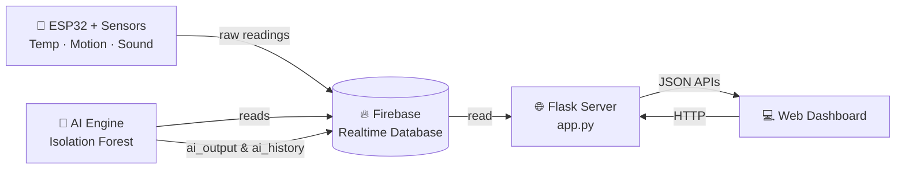

<div align="center">

# 🐄 Cattle AI Server

### Real-time cattle health monitoring dashboard powered by ESP32 sensors, Firebase and AI anomaly detection

[](https://cattle-ai-server.onrender.com/)
[](https://www.python.org/)
[](https://flask.palletsprojects.com/)
[](https://firebase.google.com/)
[](https://render.com/)

**[🚀 Live Demo](https://cattle-ai-server.onrender.com/)** ·
**[📊 Analytics](https://cattle-ai-server.onrender.com/analytics)** ·
**[🤖 AI Health](https://cattle-ai-server.onrender.com/ai-health)** ·
**[🚨 Alerts](https://cattle-ai-server.onrender.com/alerts)**

</div>

> ⏳ **Note:** The demo runs on Render's free tier. If nobody has visited for a while, the first load can take 30–60 seconds while the server wakes up.

---

## 📑 Table of Contents

- [✨ Features](#-features)
- [🧭 Dashboard Pages](#-dashboard-pages)
- [🏗️ How It Works](#️-how-it-works)
- [🔌 API Reference](#-api-reference)
- [📁 Project Structure](#-project-structure)
- [⚙️ Run Locally](#️-run-locally)
- [☁️ Deploy](#️-deploy)
- [🔐 Security Notes](#-security-notes)
- [🗺️ Roadmap](#️-roadmap)
- [👤 Author](#-author)

---

## ✨ Features

| | Feature | Description |
|---|---|---|
| 📡 | **Live sensor data** | Temperature, motion (accelerometer) and sound readings streamed from an ESP32 |
| 🟢 | **Online / offline detection** | Marks the device offline if no reading arrives within 30 seconds |
| 🤖 | **AI anomaly detection** | Isolation Forest model scores each reading and flags unusual patterns |
| 📈 | **Historical analytics** | View data for the last 1 hour, 24 hours or 7 days |
| 🚨 | **Smart alerts** | Warning, anomaly and high-risk events built from AI history |
| 🐮 | **Cattle profile** | Save name, breed, age and photo for the animal |
| 📱 | **Multi-page dashboard** | Separate pages for overview, analytics, AI health, alerts, profile and settings |

---

## 🧭 Dashboard Pages

| Page | Route | Purpose |
|---|---|---|
| 🏠 Dashboard | [`/`](https://cattle-ai-server.onrender.com/) | Live overview of the cattle's current status |
| 📊 Analytics | [`/analytics`](https://cattle-ai-server.onrender.com/analytics) | Charts of historical sensor data |
| 🤖 AI Health | [`/ai-health`](https://cattle-ai-server.onrender.com/ai-health) | Anomaly scores and health status from the AI model |
| 🚨 Alerts | [`/alerts`](https://cattle-ai-server.onrender.com/alerts) | Timeline of warnings, anomalies and high-risk events |
| 🐮 Profile | [`/profile`](https://cattle-ai-server.onrender.com/profile) | Cattle details and photo |
| ⚙️ Settings | [`/settings`](https://cattle-ai-server.onrender.com/settings) | Dashboard preferences |

---

## 🏗️ How It Works



<details>
<summary><b>📖 Click to expand: step-by-step data flow</b></summary>

1. The **ESP32** reads temperature, accelerometer and sound sensors and uploads them to Firebase (`/cows/cow_001/live` and `raw_history`).
2. The **AI engine** reads new readings, scores them with an Isolation Forest model and writes results to `ai_output` and `ai_history`.
3. The **Flask server** reads from Firebase and exposes JSON APIs plus the HTML pages.
4. The **dashboard** calls those APIs and shows live values, charts and alerts.

</details>

<details>
<summary><b>🗄️ Click to expand: Firebase data layout</b></summary>

```text
cows/
└── cow_001/
    ├── live/          # latest sensor reading (with timestamp)
    ├── raw_history/   # past sensor readings
    ├── ai_output/     # latest AI result
    ├── ai_history/    # past AI results
    └── profile/       # name, breed, age, photo
```

</details>

---

## 🔌 API Reference

<details>
<summary><b>📡 GET /api/live</b> — latest sensor data + AI output</summary>

Returns the current reading, online status and data age.

```json
{
  "success": true,
  "cow_id": "cow_001",
  "online": true,
  "data_age_seconds": 3.2,
  "live": { "...": "latest sensor values" },
  "ai": { "...": "latest AI output" }
}
```

Returns `404` if no sensor data exists yet.

</details>

<details>
<summary><b>🕒 GET /api/history</b> — last 100 sensor records</summary>

Returns recent readings: temperature, acceleration magnitude, sound peak and validity flags.

</details>

<details>
<summary><b>📈 GET /api/analytics-history?range=1h|24h|7d</b> — sensor history by time range</summary>

| Parameter | Values | Default |
|---|---|---|
| `range` | `1h`, `24h`, `7d` | `1h` |

Returns `400` for an invalid range.

</details>

<details>
<summary><b>🤖 GET /api/ai-history</b> — AI anomaly scores</summary>

Returns up to 500 records from the trained model, including `anomaly_score`, `is_anomaly`, `health_status` and `risk_score`.

</details>

<details>
<summary><b>🚨 GET /api/alerts</b> — alert events and current monitoring status</summary>

Builds alerts from the latest 2000 AI records, classified as:

- 🔴 `high_risk`
- 🟠 `anomaly`
- 🟡 `warning`

Also returns a `monitoring` object with the current online and AI status.

</details>

<details>
<summary><b>🐮 GET / POST /api/profile</b> — cattle profile</summary>

**POST body:**

```json
{
  "name": "Gauri",
  "breed": "Gir",
  "age": 4,
  "photo": "data:image/jpeg;base64,..."
}
```

- `name` is required (max 80 characters)
- `age` must be between 0 and 40
- `photo` must be a base64 image (about 500 KB max)

</details>

---

## 📁 Project Structure

```text
Cattle_AI_Server/
├── app.py                  # Flask server and APIs
├── ai_engine.py            # AI anomaly detection engine
├── templates/              # HTML pages (dashboard, analytics, alerts, ...)
├── static/
│   └── js/                 # Frontend scripts
├── CattleAI_Enclosures.scad  # 3D-printable enclosure design
├── requirements.txt        # Web server dependencies
├── requirements-ai.txt     # Extra dependencies for the AI engine
├── vercel.json             # Optional Vercel config
└── README.md
```

---

## ⚙️ Run Locally

<details open>
<summary><b>🖥️ Click to expand / collapse</b></summary>

**1. Clone the repo**

```bash
git clone https://github.com/PARA639/Cattle_AI_Server.git
cd Cattle_AI_Server
```

**2. Create a virtual environment and install dependencies**

```bash
python -m venv venv
venv\Scripts\activate          # Windows
# source venv/bin/activate     # macOS / Linux

pip install -r requirements.txt
```

To also run the AI engine:

```bash
pip install -r requirements-ai.txt
```

**3. Add your Firebase credentials**

Download a service account key from **Firebase Console → Project Settings → Service accounts** and save it as `serviceAccountKey.json` in the project root.

> ⚠️ This file is listed in `.gitignore`. **Never commit it.**

**4. Start the server**

```bash
python app.py
```

Open **http://127.0.0.1:5000**

</details>

---

## ☁️ Deploy

<details>
<summary><b>🚀 Deploy on Render (used for the live demo)</b></summary>

| Setting | Value |
|---|---|
| Language | Python 3 |
| Build Command | `pip install -r requirements.txt` |
| Start Command | `gunicorn app:app` |
| Environment Variable | `FIREBASE_SERVICE_ACCOUNT` = full contents of `serviceAccountKey.json` |

Every push to `main` triggers an automatic redeploy.

</details>

<details>
<summary><b>▲ Deploy on Vercel</b></summary>

1. Import the repo on [vercel.com](https://vercel.com)
2. Add the `FIREBASE_SERVICE_ACCOUNT` environment variable
3. Deploy. `vercel.json` is already included.

</details>

---

## 🔐 Security Notes

- Firebase credentials are read from the `FIREBASE_SERVICE_ACCOUNT` environment variable in production. They are never stored in the repo.
- The current API has **no authentication**. Anyone with the URL can read data and update the profile. Add a login or token check before using this with sensitive data.
- Keep `serviceAccountKey.json` and `.env` out of Git.

---

## 🗺️ Roadmap

- [x] Live sensor dashboard
- [x] Isolation Forest anomaly detection
- [x] Alerts timeline
- [x] Cattle profile with photo
- [x] Cloud deployment
- [ ] User login and authentication
- [ ] Multi-cattle support
- [ ] SMS / push notifications for high-risk alerts
- [ ] Downloadable health reports

---

## 👤 Author

**Paranjay Rathore**

[](https://github.com/PARA639)

---

<div align="center">

⭐ If you like this project, give it a star on GitHub!

**[🌐 Open the Live Dashboard](https://cattle-ai-server.onrender.com/)**

</div>
